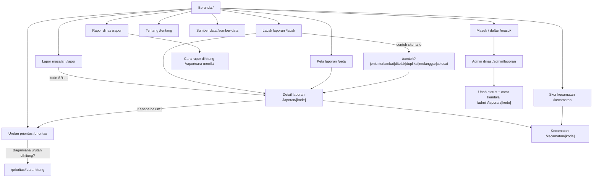

# SUARAKYAT

**Coba langsung: https://suarakyatt.vercel.app**

Warga Jakarta bisa melaporkan masalah kota (jalan rusak, saluran tersumbat, sampah, lampu jalan mati), melacak penanganannya dengan kode laporan, dan melihat **kenapa satu masalah ditangani lebih dulu dari yang lain**, dalam bahasa sehari-hari. Dibuat untuk lomba Web in Action (WIA) MIA 2026, tema *Designing Digital Futures*.

## Latar belakang dan tujuan

- **Masalahnya:**
  - Aplikasi pengaduan resmi (JAKI, LAPOR!) sudah bisa melacak status laporan, tetapi warga tidak bisa melihat **dasar urutan perbaikan**: kenapa jalan di satu tempat diperbaiki lebih dulu.
  - Dinas mana yang lambat juga tidak terlihat.
  - Studi usulan langsung e-Musrenbang DKI tahun 2019 mencatat 254 dari 18.221 usulan terealisasi (±1,4%); angka ini bukan persentase seluruh Musrenbang lintas tahun.
- **Tujuannya:** membuka alasan di balik urutan itu, supaya warga bisa memeriksa dan mengusulkan perubahan dengan data.
  - Skor prioritas per masalah per kecamatan dari 6 hal yang dinilai, semuanya terbuka dan bisa dicoba aturannya sendiri.
  - Rapor dinas A–E yang selalu tampil bersama persen laporan yang ditolak.
- **Untuk siapa:** semua warga, termasuk yang tidak terbiasa membaca angka.
  - Seluruh teks memakai satu kamus istilah sehari-hari (`lib/kamus.ts`).
  - Ada tombol "Perbesar huruf".
  - Aksesibilitas diuji dengan axe-core dan Lighthouse.

## Tech stack

- **Frontend:** Next.js (App Router), TypeScript, Tailwind CSS
- **Backend dan database:** Supabase (Postgres + PostGIS, Auth, Storage, RPC)
- **Peta dan grafik:** Leaflet + OpenStreetMap, grafik SVG/CSS buatan sendiri (paket Recharts terpasang tetapi belum dipakai)
- **Hosting:** Vercel (termasuk Vercel Cron)
- **Skrip data:** Python (pandas, geopandas)

## Cara menjalankan

```bash
git clone https://github.com/GedeAnanda/suarakyatt.git
cd suarakyatt
npm install
cp .env.example .env.local   # isi nilainya; minta ke ketua tim
npm run dev
```

Buka `http://localhost:3000`.

Untuk menyiapkan database dari nol:

1. Jalankan semua file di `supabase/migrations/` berurutan menurut nomornya lewat SQL editor Supabase atau `supabase db push`.
2. Jalankan skrip data dan seed sesuai `scripts/README.md`.

Tes modul skor: `npm test`.

## Fitur dan pemeriksaan

Beranda interaktif, login/daftar, peta publik, formulir laporan, pelacakan, tindak lanjut dinas (admin), rapor dinas, urutan prioritas dengan “Coba atur sendiri”, panel “Kenapa belum?”, dan skor 42 kecamatan (`/kecamatan`) sudah tersedia. Seluruh teks memakai bahasa sehari-hari dengan satu kamus istilah (`lib/kamus.ts`, lihat `docs/audit-awam-2026-11-10.md`). Halaman lacak menampilkan “Status sekarang” di atas peta: alasan tunda dari dinas, alasan penolakan, dan tautan ke laporan asli untuk duplikat. Percobaan aturan, jenis masalah, dan masalah terpilih bisa dibagikan lewat URL. Tautan `/contoh` memilih laporan yang tersedia dari sumber data aktif; `/contoh?jenis=terlambat|ditolak|duplikat|melanggar|selesai` membuka tiap skenario.

```bash
npm run lint
npm test
npm run build
npm run test:db  # memerlukan DATABASE_URL; semua mutasi pengujian di-rollback
```

Database demo dapat diisi dengan `npm run demo:setup -- --apply` setelah migrasi dan akun demo tersedia. Skrip hanya menerima database kosong. Panduan ada di [scripts/README.md](scripts/README.md).

## Alur presentasi lomba

1. Buka Beranda. Ubah pilihan di “Urutan bisa berubah, tergantung apa yang diutamakan” dan jelaskan perubahan urutannya.
2. Buka Urutan prioritas. Pilih jenis masalah dan masalahnya, coba pilihan cepat atau atur sendiri, lalu bagikan URL percobaannya.
3. Buka `/lacak`, lalu coba skenario “Terlambat, ada kendala” dan “Ditolak karena duplikat”. Di HP, alasan tunda dan alasan tolak langsung terlihat di kotak “Status sekarang”; panel “Kenapa belum?” menjelaskan posisi model. Peringkat bukan janji tanggal perbaikan.
4. Buka `/kecamatan`, pilih satu kecamatan, dan baca kalimat serta grafik posisinya di antara 42 kecamatan.
5. Masuk sebagai warga demo untuk melapor atau mendukung laporan yang sudah ada.
6. Masuk sebagai admin demo untuk memverifikasi dan memproses laporan kategori Jalan rusak, lalu catat kendalanya (“Belum bisa diselesaikan? Catat kendalanya”).
7. Buka rapor: tunjukkan denominator laporan terlambat dan pembatasan huruf ketika tingkat penolakan tinggi.

Fokus subtema: **Data-Driven Decision Support** dan **Civic Reporting & Accountability**, didukung **Public Service Tracking**. Laporan dan kinerja instansi adalah simulasi. Sebanyak 42 baris demografi beratribusi BPS sudah dimuat ke database tim dan cocok dengan CSV lokal; verifikasi transkripsi terhadap publikasi BPS asal belum selesai. Cadangan frontend tetap memakai demografi simulasi. Data CRM belum terintegrasi; batas wilayah dan angka konteks Musrenbang memiliki sumber publik terpisah.

## Peta halaman (sitemap)



## Progres

| Bagian | Status |
| --- | --- |
| Lapor (foto, titik, laporan serupa, draf tersimpan) | ✅ selesai |
| Lacak + detail laporan (status, alasan tolak/tunda, riwayat, "Kenapa belum?") | ✅ selesai |
| Peta laporan (saring jenis dan status) | ✅ selesai |
| Urutan prioritas + "Coba atur sendiri" + cara hitung | ✅ selesai |
| Skor kecamatan (42 kecamatan, kalimat awam, grafik posisi) | ✅ selesai |
| Rapor dinas A–E + cara rapor dihitung | ✅ selesai |
| Admin dinas: ubah status, tolak beralasan, catat kendala | ✅ selesai |
| Bahasa awam di semua halaman (135 temuan audit) | ✅ selesai, lihat `docs/audit-awam-2026-11-10.md` |
| Aksesibilitas | 🟡 Beranda, Prioritas, Sumber data: 0 temuan axe pada 320/360/390/768/1440 px; akses keyboard tabel diuji. Target peta dan uji manual masih terbuka |
| Performa HP (baseline produksi 11 Nov, sebelum perbaikan audit) | 🟡 Lighthouse: Beranda 95 / LCP 2,8 dtk; Detail 95 / 2,4 dtk; Kecamatan 100 / 1,1 dtk. Target LCP 2,5 dtk; hasil sekali ukur, belum data pengguna nyata |
| Uji ke 5 warga beragam | 🟡 kit siap (`docs/uji-warga-2026-11-10.md`), belum dijalankan |
| Demografi beratribusi BPS | 🟡 42 baris sudah dimuat dan cocok dengan CSV lokal; verifikasi publikasi asal belum selesai |
| Integrasi CRM | ⏳ belum; laporan dan kinerja dinas tetap simulasi |

## Tim

| Nama | Peran |
| --- | --- |
| Wildan (@wildanpanjii) | A · Frontend & Desain |
| Gede Ananda (@GedeAnanda) | B · Backend & Integrasi (ketua) |
| Fatih Akram Wicaksono | C · Data & Skor |

## Dokumen

- `docs/suaRAkyat_PRD_v0.3.pdf`: kebutuhan produk (apa dan kenapa)
- `docs/suaRAkyat_SDD_v1.0.pdf`: desain teknis (bagaimana)
- `CONTRIBUTING.md`: aturan kerja tim
- `docs/revisi-fds-2026-11-10.md`: catatan mentor First Draft Submission dan hasil revisinya
- `docs/audit-awam-2026-11-10.md`: audit bahasa awam, alur UX di HP, dan data, beserta kamus istilah
- `docs/uji-warga-2026-11-10.md`: kit uji ke 5 warga beragam (tugas, batas waktu, lembar catat)

Versi terbaru kedua dokumen ada di link dokumen online tim; PDF di folder `docs/` adalah salinan.

## Data

Laporan, dinas, dan nilai rapor di aplikasi ini adalah **data buatan** untuk lomba dan diberi label "Data buatan" di setiap halaman. Batas kecamatan dan peta memakai data asli. Sumber dan lisensinya tercantum di halaman Sumber data.
