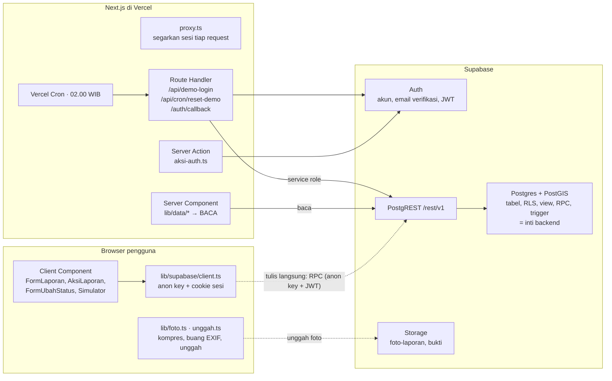
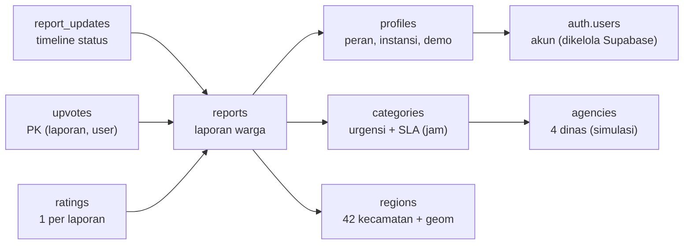
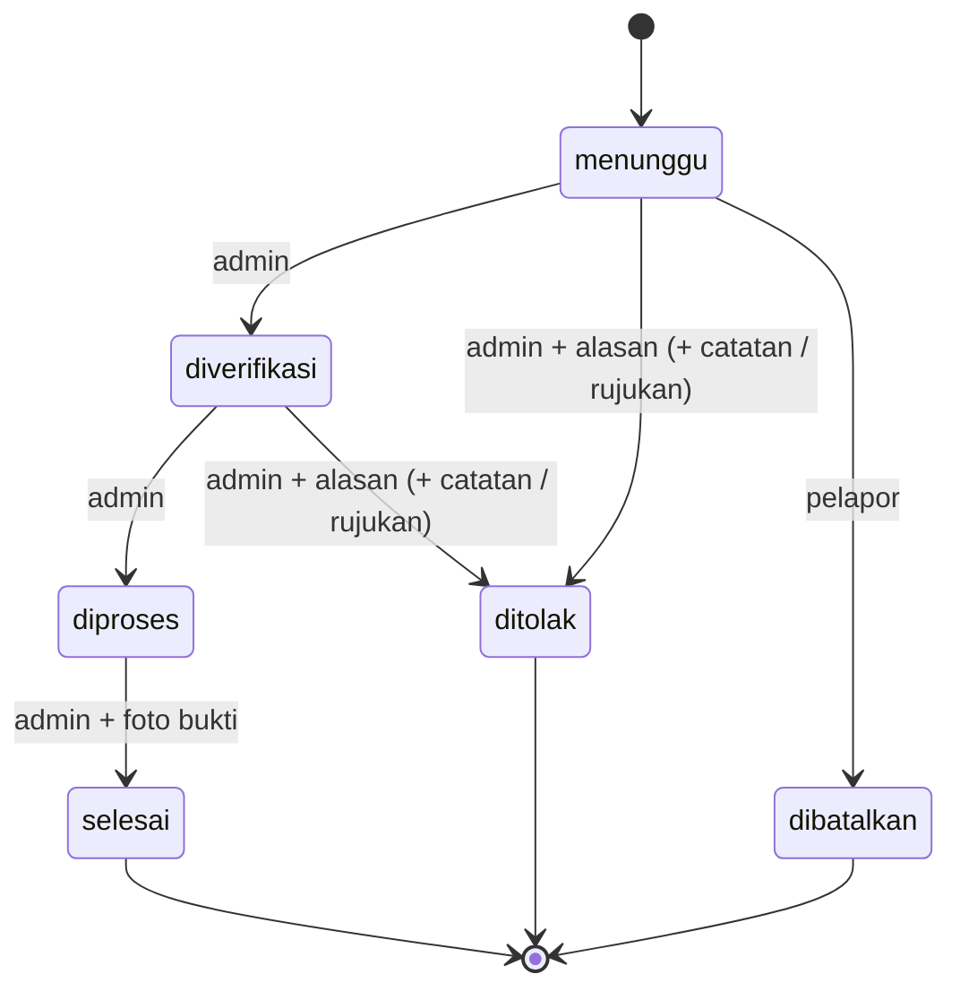

# Peta Backend suaRAkyat

> Versi Markdown dari `Peta-Backend-suaRAkyat.pdf` (catatan belajar untuk B · Backend & Integrasi, 27 Okt 2026; PDF-nya ada di folder induk repo). Isi sama dengan PDF. Tiga gambar di PDF ditulis ulang sebagai diagram Mermaid (tampil di GitHub dan preview Markdown VS Code). Angka "520 laporan" di dokumen ini adalah kondisi 27 Okt; sejak 28 Okt database berisi 900 laporan seed dari C.

Di file mana setiap endpoint tinggal, siapa yang memanggilnya, bagaimana datanya dijaga, dan ilmu apa saja yang dipakai.

| | |
|---|---|
| Dibuat | 27 Oktober 2026 |
| Dibaca dari | branch `feat/a-polish-visual`, commit `fee97d3` |
| Stack | Next.js 16.4 (App Router) · Supabase: Postgres + PostGIS, Auth, Storage · Vercel |
| Database | proyek Supabase `feqkvqrzjizdyaeqyzwg`, migrasi `0001`–`0007` |

## Ringkasan cepat

- **Backend kita = database.** Tidak ada server Express/Laravel. Logika ada di Postgres (RPC + RLS + view + trigger); Next.js cuma lapisan tipis untuk login, cron, dan baca data.
- **Satu kalimat kunci:** "Klien hanya MEMBACA lewat RLS dan view; semua penulisan lewat RPC." Paham ini = paham 80% backend.
- **Endpoint ada 5 jenis:** Route Handler, Server Action, RPC, tabel/view (PostgREST), Storage. Cuma 3 yang berupa file `route.ts`.
- **Keamanan 8 lapis** (proxy → GRANT → RLS → view → RPC → policy Storage → rahasia server → kebersihan input). Proxy cuma kenyamanan, bukan keamanan.
- **Error mengalir** dari `raise exception 'KODE'` di SQL → `lib/errors.ts` → pesan bahasa Indonesia di layar. Tambah kode baru di SQL = tambah juga di `lib/errors.ts`.
- **Mau ubah sesuatu?** Lihat contekan di [9.3](#93-contekan-mau-ubah-x-buka-file-y).

## Isi

1. [Gambaran besar](#bab-1--gambaran-besar) — backend kita sebenarnya ada di mana
2. [Peta folder](#bab-2--peta-folder) — setiap file backend dan gunanya
3. [Daftar endpoint](#bab-3--daftar-endpoint) — lima jenis pintu masuk, semua ada di tabel
4. [Database](#bab-4--database) — tabel, relasi, status laporan, trigger, migrasi
5. [Keamanan berlapis](#bab-5--keamanan-berlapis) — delapan lapis, dari proxy sampai rahasia
6. [Kode server Next.js](#bab-6--kode-server-nextjs) — empat client Supabase, `lib/data`, alur error
7. [Alur ujung ke ujung](#bab-7--alur-ujung-ke-ujung) — lima cerita: lapor, admin, daftar, cron, bobot
8. [Ilmu yang dipakai](#bab-8--ilmu-yang-dipakai) — daftar konsep untuk dipelajari
9. [Latihan dan contekan](#bab-9--latihan-dan-contekan) — SQL yang aman dicoba, urutan baca, "mau ubah X buka Y"

## Bab 1 · Gambaran besar

suaRAkyat tidak punya server backend terpisah (Express, Laravel, dan sejenisnya). Hampir semua logika backend tinggal di database Postgres milik Supabase. Next.js hanya menambah lapisan tipis untuk login, cron, dan membaca data.



*Gambar 1. Tiga tempat kode berjalan. Garis putus-putus: penulisan data tidak lewat Next.js, tapi langsung dari browser ke fungsi RPC di database. Hanya kunci publik di browser; semua aturan dicek di DB.*

### Satu prinsip yang mengatur semuanya

> "Klien hanya MEMBACA lewat RLS dan view; semua penulisan lewat RPC."

Kalimat ini tertulis di baris ketiga `supabase/migrations/0002_views_rls.sql`. Kalau kamu paham kalimat ini, kamu paham 80% backend suaRAkyat.

1. **Membaca** dilakukan lewat tabel atau view. Baris yang boleh dilihat disaring oleh Row Level Security (RLS) di database, bukan oleh kode JavaScript.
2. **Menulis** (membuat laporan, mengubah status, mendukung, memberi rating, menyimpan bobot) hanya bisa lewat fungsi Postgres yang disebut RPC. Hak `INSERT`/`UPDATE`/`DELETE` ke tabel sudah dicabut, jadi tidak ada jalan pintas.
3. **Kunci rahasia** (service role) hanya dipakai di server, yaitu di cron reset demo.

### Kenapa dirancang begini?

- **Aturan bisnis ada di satu tempat.** Misalnya, aturan "laporan selesai wajib punya foto bukti" dicek di fungsi `update_report_status`. Apa pun frontend-nya, aturan itu tetap berlaku.
- **Frontend tidak bisa dicurangi.** Siapa pun bisa membuka DevTools dan memanggil Supabase dengan anon key. Itu aman karena database sendiri yang menolak.
- **Lebih sedikit server.** Tim tiga orang tidak perlu memelihara server API sendiri. Supabase otomatis membuat REST API dari tabel dan fungsi (PostgREST).
- **Transaksi utuh.** Satu panggilan RPC berjalan dalam satu transaksi. Contohnya, `create_report` menulis laporan dan baris timeline pertama sekaligus. Kalau salah satu gagal, keduanya batal.

## Bab 2 · Peta folder

Hanya berkas yang berhubungan dengan backend. Halaman dan komponen tampilan (milik A) sengaja disingkat.

```
suarakyat/
├─ proxy.ts                         penjaga rute; pengganti middleware.ts sejak Next.js 16
├─ vercel.json                      jadwal Vercel Cron → /api/cron/reset-demo
├─ next.config.ts                   cacheComponents aktif; izinkan gambar dari *.supabase.co
├─ .env.example                     daftar variabel lingkungan (isi di .env.local, jangan di-commit)
│
├─ app/
│  ├─ api/demo-login/route.ts       POST /api/demo-login      → masuk sebagai akun demo
│  ├─ api/cron/reset-demo/route.ts  GET  /api/cron/reset-demo → reset data demo tiap malam
│  ├─ auth/callback/route.ts        GET  /auth/callback       → tujuan tautan verifikasi email
│  └─ …/page.tsx                    halaman (milik A); ambil data lewat lib/data/*
│
├─ lib/
│  ├─ supabase/                     SEMUA cara "bicara" ke Supabase ada di sini
│  │  ├─ client.ts                  client untuk browser (Client Component)
│  │  ├─ server.ts                  client untuk Server Component, Server Action, Route Handler
│  │  ├─ proxy.ts                   client khusus proxy.ts: segarkan token sesi
│  │  ├─ admin.ts                   client service role: melewati RLS, hanya server
│  │  ├─ aksi-auth.ts               Server Action masuk(), daftar(), keluar()
│  │  ├─ unggah.ts                  unggah foto ke Storage → URL publik
│  │  └─ env.ts                     baca NEXT_PUBLIC_SUPABASE_URL dan ANON_KEY
│  ├─ data/                         baca data untuk halaman (+ cadangan data contoh)
│  │  └─ laporan.ts · admin.ts · prioritas.ts · sesi.ts
│  ├─ errors.ts                     peta kode error → pesan bahasa Indonesia
│  ├─ types.ts                      KONTRAK bentuk data database ↔ frontend
│  ├─ tujuan-aman.ts                cegah open redirect pada ?lanjut=
│  ├─ foto.ts                       kompres foto + buang EXIF di browser (milik A)
│  ├─ scoring/                      rumus skor prioritas dan rapor (milik C)
│  └─ mocks/*.json                  data contoh saat database kosong
│
├─ supabase/migrations/
│  ├─ 0001_schema.sql               tabel, enum, trigger profil, nilai awal
│  ├─ 0002_views_rls.sql            fungsi peran, RLS, view, policy Storage, GRANT
│  ├─ 0003_fn_laporan.sql           RPC tulis (R1–R7, R10, R11) + tabel seed
│  ├─ 0004_fn_rapor.sql             placeholder (TODO); isinya ada di 0007
│  ├─ 0005_fn_prioritas.sql         placeholder (TODO); isinya ada di 0007
│  ├─ 0006_data_referensi.sql       4 instansi + 4 kategori dengan SLA
│  └─ 0007_agregasi_demo.sql        priority_factors, agency_report_card, trigger demo
│
├─ scripts/
│  ├─ siapkan-demo.mjs              npm run demo:setup → isi DB kosong (42 wilayah, 520 laporan)
│  ├─ verifikasi-demo.mjs           npm run test:db    → uji RPC, semua di-rollback
│  └─ 00_*.py, 01_*.py              olah batas wilayah HDX (Python, milik C)
└─ tests/                           npm test (vitest)  → rumus skor dan rapor
```

### Cara cepat menebak lokasi kode

- Ada URL `/api/...` atau `/auth/...`? Cari `app/<path>/route.ts`.
- Ada `supabase.rpc('nama')`? Fungsinya ada di `supabase/migrations/`. Cari `function public.nama`.
- Ada `supabase.from('v_...')`? Itu view; definisinya di `0002` (dan `v_timeline_publik` diperbarui di `0007`).
- Pesan error yang muncul di layar? Cari kodenya di `lib/errors.ts`, lalu cari kode yang sama di migrasi.

### Peran tim dan kepemilikan berkas

| Peran | Folder (dari CONTRIBUTING.md) |
|---|---|
| A · Frontend & Desain | `app/`, `components/`. Termasuk `lib/data/*` yang dipakai halaman. |
| B · Backend & Integrasi (ketua, kamu) | `app/api/`, `lib/supabase/`, `lib/errors.ts`, migrasi `0001`–`0003`, `0006` |
| C · Data & Skor | `lib/scoring/`, `scripts/`, `data/`, `tests/`, migrasi `0004`–`0005` (isinya kemudian di `0007`) |
| Semua | `lib/types.ts` adalah kontrak bersama dan hanya diubah dengan persetujuan kedua sisi. |

## Bab 3 · Daftar endpoint

Di proyek ini, "endpoint" ada lima jenis. Hanya tiga yang berupa file `route.ts`. Sisanya otomatis dibuat Supabase dari isi database.

| Jenis | URL yang sebenarnya dipanggil | Ditulis di | Contoh |
|---|---|---|---|
| Route Handler | `/api/**`, `/auth/callback` | `app/**/route.ts` | `POST /api/demo-login` |
| Server Action | POST ke halaman itu sendiri (diatur Next.js) | berkas `'use server'` | `masuk()`, `daftar()` |
| RPC (fungsi Postgres) | `POST …/rest/v1/rpc/<nama>` | `supabase/migrations/*.sql` | `create_report` |
| Tabel / view | `GET …/rest/v1/<nama>?select=…` | `supabase/migrations/*.sql` | `v_laporan_publik` |
| Storage | `POST …/storage/v1/object/<bucket>/<path>` | bucket di dashboard, policy di `0002` | `foto-laporan` |

"…" = nilai `NEXT_PUBLIC_SUPABASE_URL`, yaitu `https://feqkvqrzjizdyaeqyzwg.supabase.co`.

Label akses yang dipakai di tabel bab ini: **publik** semua orang termasuk tamu · **login** pengguna yang sudah masuk · **admin** peran khusus · **rahasia** hanya server.

### 3.1 Route Handler (kode Next.js)

| Endpoint · file | Akses | Yang dilakukan | Respons |
|---|---|---|---|
| `POST /api/demo-login` · `app/api/demo-login/route.ts` | publik | Body `{ peran: 'warga' \| 'admin' }` divalidasi dengan Zod. Email dan password akun demo dibaca dari env di server, jadi browser tidak pernah melihatnya. Server lalu login ke Supabase dan menulis cookie sesi. Dipanggil dari `components/TombolDemo.tsx`. | 200 `{ok, redirect}` · 400 `PERAN_TIDAK_VALID` · 500 `DEMO_BELUM_DIATUR`, `LOGIN_DEMO_GAGAL` |
| `GET /api/cron/reset-demo` · `app/api/cron/reset-demo/route.ts` | rahasia | Hanya menerima header `Authorization: Bearer <CRON_SECRET>`, dibandingkan dengan `timingSafeEqual`. Setelah itu membuat client service role dan memanggil RPC `reset_demo_data()`. Dipicu Vercel Cron `0 19 * * *` (19.00 UTC = 02.00 WIB). | 200 `{reset_at}` · 401 `TIDAK_BERWENANG` · 409 kode dari RPC, mis. `SEED_BELUM_ADA` · 500/501 konfigurasi atau fungsi belum ada |
| `GET /auth/callback` · `app/auth/callback/route.ts` | publik | Tujuan tautan di email verifikasi. Menukar `?code=` (alur PKCE) atau `?token_hash=&type=` menjadi sesi, lalu redirect ke `?lanjut=` yang sudah disaring `tujuanAman()`. | 302 ke `lanjut` · jika gagal: 302 ke `/masuk?verifikasi=gagal` |

### 3.2 Server Action · `lib/supabase/aksi-auth.ts`

| Fungsi | Yang dilakukan | Dipakai di · error |
|---|---|---|
| `masuk()` | Validasi Zod (email, password), lalu `signInWithPassword`, lalu `redirect(tujuanAman(lanjut))`. | `FormAuth.tsx` · `KREDENSIAL_SALAH`, `EMAIL_BELUM_VERIFIKASI` |
| `daftar()` | Nama 2–80 karakter, email, password ≥ 8. Lalu `signUp` dengan `data.nama`, yang dibaca trigger `handle_new_user` untuk membuat profil. Tautan email diarahkan ke `/auth/callback?lanjut=/lapor`. | `FormAuth.tsx` · `PASSWORD_LEMAH`, `BATAS_EMAIL` |
| `keluar()` | `signOut()`, lalu redirect ke `/`. | `Header.tsx` |

Fungsi `kodeAuth()` di berkas yang sama menerjemahkan kode error Supabase Auth (misalnya `invalid_credentials`) ke kode error milik kita.

### 3.3 RPC: fungsi Postgres (inti backend)

Semua fungsi di bawah ini `security definer`, punya `set search_path = public`, dan melempar error dengan pola `raise exception 'KODE' using errcode = 'P0001'`. Nomor R1–R11 mengikuti SDD bagian 6.

| Fungsi · file | Akses | Yang dilakukan | Dipanggil dari | Kode error |
|---|---|---|---|---|
| `stats_beranda()` · R1 · 0003 | publik | Total laporan, persen selesai, jumlah yang terlambat, dan jumlah per kategori. | `lib/data/laporan.ts` → `ambilStatistik` | – |
| `similar_reports(kategori, lat, lng)` · R2 · 0003 | login | Maksimal 5 laporan aktif sekategori dalam radius `app_config.radius_serupa_m` (100 m), diurutkan dari yang terdekat. | `FormLaporan.tsx` | `TIDAK_LOGIN`, `INPUT_TIDAK_VALID` |
| `create_report(kategori, deskripsi, foto[], lat, lng)` · R3 · 0003 | login | Validasi input. Kecamatan dicari dengan `st_contains`. Membuat kode acak `SR-XXXXXX`, lalu menulis laporan dan baris timeline `menunggu`. | `FormLaporan.tsx` | `INPUT_TIDAK_VALID`, `LUAR_WILAYAH` |
| `toggle_upvote(kode)` · R4 · 0003 | login | Dukung atau batal dukung. Hanya untuk laporan aktif yang bukan milik sendiri. | `AksiLaporan.tsx`, `FormLaporan.tsx` | `LAPORAN_TIDAK_AKTIF`, `UPVOTE_SENDIRI` |
| `cancel_report(kode)` · R5 · 0003 | pelapor | Mengubah `menunggu` menjadi `dibatalkan`. Baris laporan dikunci dengan `for update`. | `AksiLaporan.tsx` | `BUKAN_PEMILIK`, `TRANSISI_TIDAK_VALID` |
| `update_report_status(…7 parameter)` · R6 · 0003 | admin instansi | Mengubah status sesuai tabel transisi. Tolak wajib beralasan. Untuk duplikat, dukungan dipindah ke laporan rujukan. Selesai wajib punya foto bukti. Admin demo hanya boleh mengubah laporan simulasi atau buatan akun demo. | `FormUbahStatus.tsx` | `BUKAN_INSTANSI`, `DEMO_TERBATAS`, `TRANSISI_TIDAK_VALID`, `ALASAN_WAJIB`, `DUPLIKAT_TIDAK_VALID`, `BUKTI_WAJIB` |
| `rate_report(kode, nilai, komentar)` · R7 · 0003 | pelapor | Rating 1–5, hanya jika laporan sudah selesai, sekali per laporan. | `AksiLaporan.tsx` | `BELUM_SELESAI`, `SUDAH_DIRATING` |
| `save_weights(bobot, alasan)` · R10 · 0003 | Perencana | Enam bobot (0–1) dinormalisasi supaya jumlahnya 1. Snapshot lama dan baru dicatat di `weight_changes`. | `Simulator.tsx` | `BUKAN_PERENCANA`, `ALASAN_TERLALU_PENDEK`, `BOBOT_TIDAK_VALID` |
| `reset_demo_data()` · R11 · 0003 | service_role | Menghapus laporan simulasi dan buatan akun demo, menyalin ulang dari `seed.*`, lalu menggeser semua waktu sebesar `now() - seed_anchor`. | `/api/cron/reset-demo` | `SEED_BELUM_ADA` |
| `priority_factors(kategori?, sumber)` · R9 · 0007 | publik | Nilai mentah enam faktor per pasangan kecamatan × kategori. Normalisasi dan bobot dihitung di `lib/scoring` (browser). | `lib/data/prioritas.ts` | – |
| `agency_report_card(dari?, sampai?)` · R8 · 0007 | publik | Rapor instansi: R, S, P, K, nilai 0–100, huruf A–E, dan peringatan tingkat penolakan. | `lib/data/prioritas.ts` | – |
| `is_admin()`, `my_instansi()`, `is_perencana()` · 0002 | publik | Fungsi bantu peran untuk RLS. `proxy.ts` memanggil `is_admin` untuk menjaga `/admin`. | policy RLS, `proxy.ts` | – |

### 3.4 Tabel dan view yang dibaca

| Nama | Akses | Catatan | Dibaca oleh |
|---|---|---|---|
| `v_laporan_publik` (Q1, Q2) | publik | Hanya kolom aman. Nama pelapor diubah jadi inisial. Deskripsi dan foto dikosongkan jika ditolak karena `konten_melanggar`. Laporan `dibatalkan` disembunyikan. Opsi `security_barrier`. | `lib/data/laporan.ts` |
| `v_timeline_publik` (Q2) | publik | Riwayat status dengan label pelaku ("Pelapor", "Admin · instansi", "Catatan simulasi"). Diperbarui di `0007`. | `lib/data/laporan.ts` |
| `v_laporan_admin` (Q3) | login | Opsi `security_invoker`, jadi RLS tabel `reports` tetap berlaku: admin hanya melihat laporan instansinya. Ada kolom `terlambat`. Hak baca untuk `anon` dicabut. | `lib/data/admin.ts` |
| `v_riwayat_bobot` (Q6) | publik | Riwayat perubahan bobot tanpa `admin_id`. | `lib/data/prioritas.ts` |
| `priority_weights` (Q5) | publik | Bobot acuan saat ini. | `lib/data/prioritas.ts` |
| `profiles` | baris sendiri | Nama, peran, instansi, Perencana, demo. | `lib/data/sesi.ts` |
| `reports`, `ratings` | baris sendiri | Dipakai untuk mengecek "apakah saya pemilik laporan ini" dan "sudah memberi rating?". | `ambilHubungan` di `laporan.ts` |

### 3.5 Storage

| Bucket | Akses unggah | Aturan (policy di 0002) | Dipanggil dari |
|---|---|---|---|
| `foto-laporan` | login | Folder pertama wajib sama dengan `auth.uid()`. | `FormLaporan.tsx` → `unggahFoto` |
| `bukti` | admin | Folder = uid dan `is_admin()`. | `FormUbahStatus.tsx` → `unggahFoto` |

Path file selalu `<uid>/<uuid acak>.<ext>`, jadi nama asli file dari ponsel tidak ikut tersimpan. Batas 5 MB dan jenis JPG/PNG/WebP diatur di pengaturan bucket di dashboard Supabase, bukan di file migrasi. Ingat ini kalau suatu saat proyek Supabase dibuat ulang.

## Bab 4 · Database

Satu skema `public` untuk data aplikasi dan satu skema `seed` untuk salinan data demo. Ekstensi PostGIS dipakai untuk peta.

### 4.1 Relasi utama



*Gambar 2. Panah menunjuk ke tabel yang dirujuk (foreign key). Contoh: `reports.region_id → regions.id`. Pengguna dan instansi berhubungan lewat `profiles.instansi_id → agencies.id` (tidak digambar).*

### 4.2 Semua tabel

| Tabel | Isi dan kolom penting | Catatan |
|---|---|---|
| `app_config` | Pasangan `kunci` → `nilai` (jsonb): `radius_serupa_m`=100, `batas_upvote`=10, `ambang_tolak_*`, `sampel_min_rapor`, `seed_anchor`. | Angka yang bisa disetel tanpa deploy. |
| `agencies` | Instansi; `is_simulated`. | Id 1–4 dikunci di `0006`. |
| `categories` | `instansi_id`, `urgensi`, `sla_respons_jam`, `sla_selesai_jam`. | Kategori menentukan dinas, jadi pelapor tidak memilih dinas. |
| `regions` | `kode_wilayah` (unik, format `31.73.040`), `geom` MultiPolygon 4326, `penduduk`, `luas_km2`, `persen_miskin`, `sumber`. | Index GiST di `geom`. Saat ini demografinya masih simulasi. |
| `profiles` | 1:1 dengan `auth.users`. `role` (warga/admin), `instansi_id`, `kelola_prioritas` (= Perencana), `is_demo`. | CHECK: hanya admin yang boleh punya instansi atau hak Perencana. |
| `reports` | `kode` unik, `deskripsi` 20–500 karakter, `foto` 1–3 URL, `lokasi` geography Point, `status`, `responded_at`, `resolved_at`, `is_simulated`. | Index GiST di `lokasi` dan index gabungan (status, kategori, wilayah). |
| `report_updates` | Satu baris per perubahan status. `admin_id` null berarti aksi pelapor. `alasan_tolak`, `duplikat_dari`, `catatan`, `bukti_url`. | Empat CHECK menjamin bentuk data (lihat 4.3). |
| `upvotes`, `ratings` | Dukungan (PK gabungan) dan rating (PK `report_id`, jadi otomatis satu per laporan). | |
| `priority_weights`, `weight_changes` | Enam bobot saat ini, serta riwayat perubahan (bobot lama, bobot baru, alasan ≥ 10 karakter). | Jejak keputusan publik. |
| `priority_overrides`, `keberatan`, `crm_agregat` | Fitur "sebaiknya ada". Tabel sudah ada, tapi belum ada RPC untuk menulis ke dalamnya. | |
| `seed.reports`, `seed.report_updates`, `seed.upvotes`, `seed.ratings` | Salinan data demo, strukturnya sama dengan tabel `public`. | Sumber untuk `reset_demo_data()`. |

### 4.3 Siklus status laporan



*Gambar 3. Transisi yang diizinkan. Dicek di `update_report_status` (admin) dan `cancel_report` (pelapor). Panggilan lain ditolak dengan `TRANSISI_TIDAK_VALID`. Dari selesai, ditolak, dan dibatalkan tidak ada jalan keluar. Dukungan hanya untuk 3 status aktif pertama.*

Ada dua lapis penjaga. Fungsi RPC memeriksa transisi dan memberi pesan error yang jelas. CHECK constraint di `report_updates` menjadi jaring pengaman terakhir: status `ditolak` wajib punya alasan, alasan `duplikat` wajib punya rujukan, alasan `tidak_valid`/`konten_melanggar` wajib punya catatan, dan status `selesai` wajib punya `bukti_url`. Jadi meskipun suatu hari ada bug di fungsi, data yang salah bentuk tetap tidak bisa masuk.

### 4.4 Trigger

| Trigger → fungsi | File | Kapan dan untuk apa |
|---|---|---|
| `on_auth_user_created` → `handle_new_user()` | 0001 | Setelah akun baru dibuat di `auth.users`: membuat baris `profiles`. Nama diambil dari metadata `nama` (dikirim `daftar()`) atau dari bagian depan email. |
| `tandai_laporan_demo` | 0007 | Sebelum insert ke `reports`: jika pelapornya akun demo, `is_simulated` otomatis true. Laporan dari demo lalu ikut terhapus saat reset. |

### 4.5 Migrasi

| File | Isi |
|---|---|
| `0001_schema.sql` | Ekstensi PostGIS, skema `seed`, 4 enum, 14 tabel, trigger profil, nilai awal `app_config` dan `priority_weights`. |
| `0002_views_rls.sql` | Fungsi peran, RLS di semua tabel, 4 view, policy Storage, lalu `revoke all` + `grant select`. |
| `0003_fn_laporan.sql` | RPC R1–R7, R10, R11, tabel `seed.*`, FK `duplikat_dari` dibuat deferrable, hak eksekusi per fungsi. |
| `0004`, `0005` | Hanya TODO dari C. Isinya diwujudkan di `0007`. |
| `0006_data_referensi.sql` | 4 instansi + 4 kategori. Aman dijalankan ulang (`on conflict do nothing`). |
| `0007_agregasi_demo.sql` | `priority_factors`, `agency_report_card`, trigger demo, `v_timeline_publik` versi baru, lalu `notify pgrst, 'reload schema'`. |

> **Aturan migrasi**
> - File yang sudah diterapkan tidak boleh diedit. Perubahan apa pun masuk ke file baru dengan nomor berikutnya (berikutnya `0008_...sql`).
> - Untuk mengubah fungsi, tulis ulang dengan `create or replace function` di file baru. Untuk view, pakai `create or replace view`.
> - Selalu uji dulu di dalam `begin; … rollback;`, baru terapkan sungguhan. Pastikan `DATABASE_URL` menunjuk ke proyek yang benar.
> - Setelah fungsi atau view berubah, jalankan `notify pgrst, 'reload schema';` supaya API Supabase langsung mengenalinya.

## Bab 5 · Keamanan berlapis

Tidak ada satu lapis pun yang dianggap cukup. Kalau satu lapis bocor, lapis berikutnya masih menahan. Konsep ini disebut *defense in depth*.

1. **`proxy.ts`: kenyamanan, bukan keamanan.** Tamu yang membuka `/lapor` atau `/admin` diarahkan ke `/masuk?lanjut=…`. Non-admin di `/admin` diarahkan ke `/`. Komentarnya sendiri menulis: "keamanan sebenarnya tetap di RLS dan RPC."
2. **Hak tabel (GRANT/REVOKE)** di `0002` bagian 5. Supabase awalnya memberi `anon` dan `authenticated` semua hak. Kita cabut semuanya, lalu hanya memberi `SELECT`. Satu-satunya pengecualian: `UPDATE (nama)` di `profiles`.
3. **Row Level Security.** Menentukan *baris* mana yang boleh dibaca. Pelapor hanya melihat laporannya sendiri, admin hanya melihat laporan kategori instansinya, Perencana melihat semua. Data referensi (wilayah, kategori, bobot) terbuka untuk publik.
4. **View.** Menentukan *kolom* mana yang boleh dilihat publik. `v_laporan_publik` tidak memuat `user_id`. Opsi `security_barrier` mencegah filter di view dibocorkan lewat fungsi di `WHERE`. Sebaliknya, `v_laporan_admin` memakai `security_invoker` supaya RLS pemanggil tetap berlaku.
5. **RPC `security definer`: satu-satunya pintu tulis.** Fungsi berjalan dengan hak pemiliknya (postgres), tapi setiap fungsi memeriksa sendiri `auth.uid()`, peran, kepemilikan, dan transisi. Hak `EXECUTE` diberikan per fungsi: `reset_demo_data` hanya untuk `service_role`.
6. **Policy Storage.** Pengguna hanya bisa mengunggah ke folder bernama uid-nya sendiri. Bucket `bukti` hanya untuk admin.
7. **Rahasia di server.** `admin.ts` memakai `import 'server-only'`, jadi build gagal kalau berkas itu terimpor ke browser. `CRON_SECRET` dibandingkan dengan `timingSafeEqual`. Kredensial demo hanya dibaca di route handler.
8. **Kebersihan input.** Zod di route handler dan Server Action. `tujuanAman()` mencegah open redirect. Foto dikompres ulang di browser sehingga EXIF (termasuk lokasi GPS) terbuang. Nama file diganti UUID.

### Tiga konsep yang paling sering membingungkan

**`security definer` vs `security invoker`.** *Definer:* kode berjalan dengan hak pembuat fungsi atau view, jadi RLS tidak berlaku. Ini yang membuat `create_report` bisa menulis ke `reports` walaupun pengguna tidak punya hak `INSERT`. Akibatnya, fungsi itu wajib memeriksa sendiri siapa pemanggilnya. *Invoker:* kode berjalan dengan hak pemanggil, jadi RLS tetap berlaku. Ini dipakai di `v_laporan_admin`.

**Kenapa selalu ada `set search_path = public`?** Fungsi `security definer` berjalan dengan hak tinggi. Kalau `search_path` tidak dikunci, penyerang bisa membuat tabel atau fungsi tiruan di skema lain yang ikut terbaca lebih dulu. Mengunci `search_path` menutup celah itu.

**Anon key itu publik. Kok aman?** `NEXT_PUBLIC_SUPABASE_ANON_KEY` memang ikut terkirim ke browser. Kunci itu hanya menyatakan "saya aplikasi suaRAkyat", bukan "saya boleh apa saja". Hak sebenarnya ditentukan oleh JWT pengguna (`auth.uid()`), RLS, dan GRANT. Kunci yang tidak boleh bocor adalah `SUPABASE_SERVICE_ROLE_KEY`, karena kunci itu melewati RLS.

Satu lagi: policy RLS menulis `(select auth.uid())`, bukan `auth.uid()` saja. Dengan dibungkus `select`, Postgres menghitungnya sekali per query, bukan sekali per baris. Hasilnya sama, hanya lebih cepat.

> **Uji pikiran** (sudah dibuktikan di database, 27 Okt 2026, dalam transaksi yang di-rollback)
> - Pengguna login menjalankan `update reports set status='selesai' …` langsung. Hasilnya: `42501 permission denied for table reports` (lapis 2).
> - Tamu (`anon`) membaca tabel `reports`: 0 baris, karena tidak ada policy untuk anon (lapis 3). Tamu membaca `v_laporan_publik`: 520 baris (lapis 4).
> - Titik di Bandung dikirim ke `create_report`: `P0001 LUAR_WILAYAH` (lapis 5).

## Bab 6 · Kode server Next.js

Bagian backend yang ditulis dalam TypeScript: cara membuat client Supabase, lapisan baca data untuk halaman, dan perjalanan sebuah error dari SQL sampai ke layar.

### 6.1 Empat client Supabase, satu untuk tiap tempat

| File | Dipakai di | Kunci | RLS? | Catatan |
|---|---|---|---|---|
| `lib/supabase/client.ts` | Client Component (browser) | anon + cookie | ya | Dipakai untuk RPC tulis dan unggah foto. |
| `lib/supabase/server.ts` | Server Component, Server Action, Route Handler | anon + cookie | ya | Buat baru di setiap request, jangan disimpan global. `server-only`. |
| `lib/supabase/proxy.ts` | `proxy.ts` | anon + cookie | ya | Memanggil `getClaims()` untuk memverifikasi dan menyegarkan token, lalu menulis cookie baru ke respons. |
| `lib/supabase/admin.ts` | Route Handler cron saja | service role | **tidak** | Melewati semua RLS. `server-only`. Jangan dipakai untuk aksi pengguna. |

### Bagaimana sesi login hidup

1. Setelah login, Supabase memberi JWT (token berisi `sub` = uid pengguna, berlaku sebentar) dan refresh token. `@supabase/ssr` menyimpannya di cookie.
2. Setiap request melewati `proxy.ts`, yang memanggil `updateSession()`. Jika JWT hampir habis, token disegarkan dan cookie baru ditulis ke respons.
3. Server Component membaca cookie lewat `server.ts`. Komponen ini tidak bisa menulis cookie, sehingga `setAll` dibungkus `try/catch`. Itu aman karena proxy sudah menyegarkan sesi.
4. Saat browser memanggil RPC, JWT ikut terkirim. Di database, `auth.uid()` membaca `sub` dari JWT itu.

### 6.2 Lapisan baca data: `lib/data/*`

Halaman tidak memanggil Supabase secara langsung. Halaman memanggil fungsi di `lib/data`, yang mengikuti pola yang sama:

```ts
try {
  const { data, error } = await supabase.from('v_laporan_publik').select(KOLOM);
  if (!error && data.length > 0) return { sumber: 'db', laporan: data };
} catch { /* Supabase belum diatur / tidak terjangkau */ }
return { sumber: 'contoh', laporan: dataContoh };   // lib/mocks/*.json, diberi label "Data contoh"
```

- `import 'server-only'`: berkas ini tidak boleh terbawa ke browser.
- `await connection()`: menandai fungsi sebagai dinamis (dijalankan per request). Ini diperlukan karena `cacheComponents: true` aktif di `next.config.ts`.
- `cache()` dari React: kalau fungsi yang sama dipanggil beberapa kali dalam satu request, database hanya ditanya sekali.

| Halaman | Fungsi di `lib/data` | Sumber di database |
|---|---|---|
| `/` (Beranda) | `ambilStatistik`, `ambilDataPrioritas`, `ambilRapor`, `ambilContohLaporan`, `kodeLaporanUntukIsu` | `stats_beranda`, `priority_factors`, `agency_report_card`, `v_laporan_publik` |
| `/peta` | `ambilTitikLaporan` | `v_laporan_publik` (maks. 2000 titik) |
| `/laporan/[kode]` | `ambilDetailLaporan`, `ambilHubungan`, `ambilDataPrioritas` | `v_laporan_publik`, `v_timeline_publik`, `reports`, `ratings` |
| `/admin/laporan` (+ `/[kode]`) | `ambilLaporanAdmin`, `ambilLaporanAdminDetail`, `ambilSesi` | `v_laporan_admin` (disaring RLS per instansi) |
| `/prioritas` | `ambilDataPrioritas`, `ambilSesi` | `priority_factors`, `priority_weights`, `v_riwayat_bobot` |
| `/rapor` | `ambilRapor` | `agency_report_card` |
| `/contoh` | `ambilContohLaporan` | `v_laporan_publik` |
| Header (semua halaman) | `ambilSesi` | `profiles` (baris sendiri) |

### 6.3 Perjalanan sebuah error

1. SQL melempar `raise exception 'LUAR_WILAYAH' using errcode = 'P0001'`
2. PostgREST membalas HTTP 400 berisi `{"code": "P0001", "message": "LUAR_WILAYAH"}`
3. supabase-js mengembalikan `{ error }` dari `.rpc(…)`, dengan `error.message` berisi kode
4. `lib/errors.ts`: `pesanError(error)` mencari kode itu di `PESAN_ERROR`
5. Layar menampilkan "Lokasi di luar wilayah layanan (DKI Jakarta daratan)."

Kode yang tidak dikenal akan menjadi pesan umum "Terjadi kesalahan…". Jadi, setiap kali menambah kode error baru di SQL, tambahkan juga baris pesannya di `lib/errors.ts`. Error dari Supabase Auth diterjemahkan dulu oleh `kodeAuth()`. Error dari `unggahFoto()` dilempar sebagai `new Error('UNGGAH_GAGAL')`, jadi alurnya sama.

### 6.4 Variabel lingkungan

| Nama | Sifat | Dipakai di |
|---|---|---|
| `NEXT_PUBLIC_SUPABASE_URL`, `NEXT_PUBLIC_SUPABASE_ANON_KEY` | publik | `env.ts` → semua client. Awalan `NEXT_PUBLIC_` membuatnya ikut masuk ke kode browser. |
| `SUPABASE_SERVICE_ROLE_KEY` | rahasia | `lib/supabase/admin.ts` |
| `CRON_SECRET` | rahasia | `/api/cron/reset-demo`. Vercel mengirimnya otomatis sebagai Bearer. |
| `DEMO_WARGA_*`, `DEMO_ADMIN_*` | rahasia | `/api/demo-login` |
| `DATABASE_URL` | rahasia | Skrip `demo:setup` dan `test:db` (koneksi Postgres langsung). |

## Bab 7 · Alur ujung ke ujung

Lima cerita yang menghubungkan semua bagian. Ikuti nama file di setiap langkah. Kalau dibaca sambil membuka kodenya, semuanya jadi lebih masuk akal.

### A. Warga membuat laporan

1. Warga membuka `/lapor`. `proxy.ts` melihat belum ada sesi, lalu mengarahkan ke `/masuk?lanjut=/lapor`. Setelah login, warga kembali ke `/lapor`.
2. Warga memilih foto. `lib/foto.ts › kompresFoto` menggambar ulang foto di canvas (sisi maksimal 1600 px, WebP) sehingga EXIF terbuang.
3. Warga menaruh pin dan memilih kategori. Setelah jeda 450 ms, `FormLaporan.tsx` memanggil RPC `similar_reports`. Kalau ada laporan serupa dalam radius 100 m, warga ditawari untuk mendukung laporan itu saja (`toggle_upvote`).
4. Warga menekan kirim. Setiap foto diunggah lewat `unggahFoto('foto-laporan', blob)` ke `foto-laporan/<uid>/<uuid>.webp`, dan hasilnya berupa URL publik.
5. RPC `create_report`: cek login, validasi panjang deskripsi dan jumlah foto, cari kecamatan dengan `st_contains`, buat kode `SR-` acak (alfabet tanpa O/0/I/1), lalu INSERT ke `reports` + `report_updates`. Trigger `tandai_laporan_demo` ikut berjalan.
6. Browser diarahkan ke `/laporan/SR-XXXXXX?baru=1`. Server Component membaca `v_laporan_publik` + `v_timeline_publik` lewat `ambilDetailLaporan`.

### B. Admin instansi menindaklanjuti

1. Admin membuka `/admin/laporan`. `proxy.ts` memanggil RPC `is_admin()`; kalau hasilnya bukan true, admin diarahkan ke `/`.
2. `ambilLaporanAdmin` membaca `v_laporan_admin`. Karena view-nya `security_invoker`, RLS "admin baca laporan instansinya" membatasi barisnya. Urutannya: yang terlambat dulu, lalu yang paling dekat batas selesai.
3. Di `FormUbahStatus.tsx`, admin memilih status baru. Untuk `selesai`, foto bukti diunggah dulu ke bucket `bukti`.
4. RPC `update_report_status`: cek peran admin, kunci baris (`for update`), cek instansi, cek batasan akun demo, cek transisi, cek alasan/rujukan/bukti, perbarui `reports` (termasuk mengisi `responded_at`/`resolved_at`), lalu tambah baris timeline.

### C. Daftar, verifikasi email, masuk

1. `FormAuth.tsx` memanggil Server Action `daftar()`, yang memvalidasi dengan Zod lalu memanggil `supabase.auth.signUp` (nama ikut dikirim sebagai metadata).
2. Supabase membuat baris di `auth.users`. Trigger `handle_new_user` membuat `profiles` dengan peran bawaan `warga`.
3. Pengguna mengklik tautan di email dan masuk ke `/auth/callback`. Kode di tautan ditukar menjadi sesi (cookie), lalu pengguna diarahkan ke `/lapor`.
4. Login berikutnya lewat `masuk()`. Peran admin dan Perencana diatur manual di tabel `profiles`; aplikasi tidak menyediakan cara untuk menaikkan peran sendiri.

### D. Reset demo setiap malam

1. Pukul 02.00 WIB, Vercel Cron (`vercel.json`) memanggil `GET /api/cron/reset-demo` dengan header `Authorization: Bearer <CRON_SECRET>`.
2. Route handler memeriksa header dengan `timingSafeEqual`, lalu membuat client service role (`admin.ts`).
3. RPC `reset_demo_data`: hapus jejak akun demo dan laporan simulasi, salin ulang dari `seed.*`, dan geser semua waktu sebesar `now() - seed_anchor` supaya data demo selalu terasa "baru". Laporan warga sungguhan tidak dihapus; yang dibersihkan hanya dukungan dan keberatan dari akun demo.
4. Jumlah baris yang dihapus dan disalin dicatat di log Vercel, tanpa email, nama, atau isi laporan.

### E. Simulator prioritas dan simpan bobot

1. `/prioritas` mengambil `priority_factors()`, yaitu nilai mentah enam faktor (urgensi, volume, dukungan, umur, kerentanan, kepadatan) per kecamatan × kategori.
2. `lib/scoring` di browser mengubah nilai ke skala 0–1 (min-max untuk empat faktor), mengalikannya dengan bobot, lalu menghasilkan skor 0–100 dan peringkat. Karena fungsinya murni, mudah dites (`tests/scoring.test.ts`).
3. Pengguna boleh menggeser bobot; itu hanya simulasi. Jika `sesi.perencana` bernilai true, muncul tombol simpan yang memanggil RPC `save_weights` dengan alasan minimal 10 karakter.
4. `save_weights` menormalisasi bobot, memperbarui `priority_weights`, dan mencatat snapshot di `weight_changes`. Publik bisa melihat riwayatnya lewat `v_riwayat_bobot`.

## Bab 8 · Ilmu yang dipakai

Daftar konsep yang benar-benar muncul di kode suaRAkyat. Kolom terakhir menunjukkan tempat melihat contohnya, jadi kamu bisa belajar langsung dari proyek sendiri.

### 8.1 PostgreSQL dan SQL

| Konsep | Artinya singkat | Contoh di proyek |
|---|---|---|
| JOIN, view | Menggabungkan tabel; view = query yang disimpan dengan nama. | `v_laporan_publik` (0002) |
| LEFT JOIN LATERAL | Subquery per baris yang boleh merujuk baris luar. Cocok untuk "ambil 1 baris terakhir per laporan". | baris `akhir` di `v_laporan_publik` |
| Agregasi + FILTER | `count(*) filter (where …)`: menghitung bersyarat tanpa CASE. | `stats_beranda`, `agency_report_card` |
| JSONB | Kolom atau nilai JSON biner. `jsonb_build_object` dan `jsonb_agg` menyusun respons RPC. | semua RPC, `app_config` |
| `percentile_cont` | Median dan persentil. | `median_respons_jam` (0007) |
| PL/pgSQL | Bahasa prosedural Postgres: `declare`, `if`, `loop`, `raise`, `found`, `%rowtype`. | `create_report`, `update_report_status` |
| Constraint | `check`, `unique`, `foreign key`, `not null`: aturan yang dijaga database sendiri. | `report_updates`, `profiles` |
| FK deferrable | Pemeriksaan FK ditunda sampai akhir transaksi. | `duplikat_dari` saat reset demo |
| Enum, identity | Tipe dengan nilai terbatas; id otomatis (`generated always as identity`). | `status_laporan`, semua id |
| Transaksi, `for update` | Semua-atau-tidak-sama-sekali; mengunci baris supaya dua admin tidak mengubah laporan yang sama bersamaan. | `cancel_report`, `update_report_status` |
| Trigger | Fungsi yang berjalan otomatis sebelum atau sesudah INSERT/UPDATE. | `handle_new_user`, `tandai_laporan_demo` |
| Index B-tree, GiST | B-tree untuk filter biasa; GiST untuk data spasial. | `reports_filter_idx`, `regions_geom_idx` |
| `on conflict` | Upsert, atau abaikan jika sudah ada. Membuat skrip aman dijalankan ulang (idempoten). | `0006`, `toggle_upvote` |

### 8.2 Geospasial (PostGIS)

| Konsep | Artinya singkat | Contoh di proyek |
|---|---|---|
| SRID 4326 (WGS 84) | Sistem koordinat lintang/bujur yang dipakai GPS dan Leaflet. | semua kolom spasial |
| `geometry` vs `geography` | `geometry`: bidang datar, cepat untuk "titik di dalam poligon". `geography`: permukaan bumi, jarak dalam meter. | `regions.geom` vs `reports.lokasi` |
| `st_makepoint(lng, lat)` | Membuat titik. Urutannya bujur dulu, baru lintang (sumber bug klasik). | `create_report` |
| `st_contains` | Apakah poligon memuat titik → menentukan kecamatan. | `create_report` |
| `st_dwithin`, `st_distance` | Dalam radius X meter? Berapa jaraknya? `st_dwithin` bisa memakai index. | `similar_reports`, cek duplikat |
| GeoJSON | Format JSON untuk bentuk peta. `st_geomfromgeojson` memuatnya ke DB. | `siapkan-demo.mjs`, `public/data/` |

### 8.3 Supabase

| Konsep | Artinya singkat | Contoh di proyek |
|---|---|---|
| PostgREST | Membuat REST API otomatis dari skema: tabel/view → `GET /rest/v1/…`, fungsi → `POST /rest/v1/rpc/…`. | semua `.from()` dan `.rpc()` |
| Auth, JWT, claims | Akun dan sesi. JWT memuat `sub` (uid) dan `role`. Di SQL dibaca dengan `auth.uid()`. | `aksi-auth.ts`, semua RPC |
| Peran Postgres | `anon` (tamu), `authenticated` (login), `service_role` (server; melewati RLS). | GRANT di 0002 dan 0003 |
| PKCE, OTP | Cara aman menukar tautan email menjadi sesi. | `/auth/callback` |
| Storage + policy | Penyimpanan file per bucket; aksesnya diatur dengan policy seperti RLS. | `unggah.ts`, 0002 bagian 4 |
| `@supabase/ssr` | Menyimpan sesi di cookie supaya terbaca di server dan browser. | `server.ts`, `proxy.ts` |

### 8.4 Next.js 16 dan TypeScript

| Konsep | Artinya singkat | Contoh di proyek |
|---|---|---|
| Server vs Client Component | Bawaan: komponen berjalan di server. `'use client'` = berjalan di browser (untuk interaksi). | `app/*/page.tsx` vs `FormLaporan.tsx` |
| Server Action | Fungsi `'use server'` yang bisa dipanggil langsung dari form; Next.js yang membuat endpoint-nya. | `aksi-auth.ts` + `useActionState` |
| Route Handler | `route.ts` yang mengekspor `GET`/`POST` = endpoint HTTP biasa. | `app/api/*` |
| `proxy.ts` | Nama baru `middleware.ts` sejak Next.js 16; berjalan sebelum setiap request yang cocok dengan `matcher`. | `proxy.ts` |
| `cacheComponents`, `connection()`, `cache()` | Model cache baru. `connection()` memaksa render per request; `cache()` menghapus panggilan ganda dalam satu request. | `lib/data/*` |
| `server-only` | Build gagal jika berkas server terimpor ke kode browser. | `admin.ts`, `server.ts` |
| Zod | Validasi data masuk saat runtime, sekaligus membentuk tipe TypeScript. | `demo-login`, `aksi-auth.ts` |
| Kontrak tipe | Satu berkas tipe yang disepakati frontend dan backend. | `lib/types.ts` |

### 8.5 Keamanan web

| Konsep | Artinya singkat | Contoh di proyek |
|---|---|---|
| Row Level Security | Aturan baris per pengguna, ditegakkan oleh database. | 0002 bagian 2 |
| Least privilege | Beri hak paling sedikit yang cukup: cabut semua, lalu buka satu per satu. | `revoke all` → `grant select` |
| Open redirect | Penyerang memakai `?lanjut=https://situs-jahat` untuk membelokkan korban. | `tujuanAman()` |
| Timing attack | Menebak rahasia dari lama waktu perbandingan. Solusinya perbandingan berwaktu konstan. | `timingSafeEqual` di cron |
| Privasi foto (EXIF) | Foto ponsel menyimpan GPS dan merek ponsel; dibuang dengan menggambar ulang foto. | `lib/foto.ts` |
| Anti-enumerasi | Pendaftaran email yang sudah ada juga dijawab "ok" supaya daftar email tidak bisa ditebak. | `daftar()` |
| Header anti-cache | Respons yang berisi cookie sesi tidak boleh disimpan CDN. | `lib/supabase/proxy.ts` |

### 8.6 Operasional dan matematika produk

| Konsep | Artinya singkat | Contoh di proyek |
|---|---|---|
| Migrasi bernomor | Riwayat skema yang berurutan dan tidak diubah setelah diterapkan. | `supabase/migrations/` |
| Uji dengan rollback | Jalankan perubahan di dalam transaksi, periksa hasilnya, lalu batalkan. Database tetap bersih. | `verifikasi-demo.mjs` |
| Cron | Jadwal format `menit jam tgl bln hari`, dalam zona UTC. | `vercel.json` |
| Min-max normalisasi | (x − min) / (max − min) mengubah angka ke skala 0–1. | `lib/scoring/index.ts` |
| Normalisasi bobot | Setiap bobot dibagi totalnya sehingga jumlahnya 1. | `save_weights`, `normalisasiBobot` |
| Prior Bayes sederhana | Kepuasan K = (jumlah bintang + 15) / (jumlah penilai + 5) / 5. Seolah ada 5 penilai bayangan bernilai 3, jadi satu rating saja tidak membuat nilai melonjak. | `lib/scoring/rapor.ts`, 0007 |

## Bab 9 · Latihan dan contekan

Semua latihan SQL di bawah ini dibuka dengan `begin;` dan ditutup dengan `rollback;`, jadi aman dijalankan di SQL Editor Supabase. Tidak ada yang tersimpan. Hasil yang tertulis sudah dicek pada 27 Okt 2026.

### 9.1 Urutan baca yang disarankan

1. `supabase/migrations/0001_schema.sql`: kenali tabelnya dulu.
2. `0002_views_rls.sql`: siapa boleh membaca apa.
3. `0003_fn_laporan.sql`: mulai dari `create_report`, lalu `update_report_status`.
4. `lib/errors.ts`: cocokkan kode error dengan yang ada di SQL.
5. `lib/supabase/*` dan `proxy.ts`: bagaimana Next.js terhubung.
6. `app/api/*/route.ts` dan `app/auth/callback/route.ts`.
7. `lib/data/laporan.ts`, lalu `components/lapor/FormLaporan.tsx`: lihat pemanggilnya.
8. `0007_agregasi_demo.sql` + `lib/scoring/`: bagian milik C.

### 9.2 Latihan

**Latihan 1: melihat RLS bekerja**

```sql
begin;
set local role anon;                      -- berpura-pura jadi tamu
select count(*) from reports;            -- 0   → tidak ada policy untuk anon
select count(*) from v_laporan_publik;   -- 520 → lewat view publik
rollback;
```

**Latihan 2: PostGIS, titik ini masuk kecamatan mana?**

```sql
select nama, kota from regions
where st_contains(geom, st_setsrid(st_makepoint(106.8272, -6.1754), 4326));
-- Monas → Gambir, Jakarta Pusat. Coba tukar urutan lng/lat dan lihat hasilnya kosong.
```

**Latihan 3: memanggil RPC sebagai pengguna tertentu**

```sql
begin;
select set_config('request.jwt.claims',
  json_build_object('sub', (select id from profiles where is_demo and role = 'warga' limit 1),
                    'role', 'authenticated')::text, true);
set local role authenticated;
select auth.uid();                                  -- uid warga demo
select create_report(1::smallint, 'Jalan berlubang cukup dalam di dekat halte',
                     array['https://contoh.test/foto.webp'], -6.1754, 106.8272);
-- {"kode":"SR-…","kecamatan":"Gambir","instansi":"Dinas Bina Jalan (simulasi)",…}
select create_report(1::smallint, 'Titik ini sengaja di luar Jakarta daratan',
                     array['x'], -6.9, 107.6);
-- ERROR: LUAR_WILAYAH
rollback;
```

Catatan: setelah sebuah error, transaksi berstatus gagal. Jalankan `rollback;` sebelum mencoba lagi.

**Latihan 4: buktikan pintu tulis hanya lewat RPC**

```sql
begin;
set local role authenticated;
update reports set status = 'selesai' where kode = (select kode from v_laporan_publik limit 1);
-- ERROR 42501: permission denied for table reports
rollback;
```

**Latihan 5: lihat endpoint dari sisi browser**

Buka aplikasi di Chrome, lalu buka DevTools → tab Network, filter `supabase`. Masuk dengan akun demo warga dan kirim laporan. Kamu akan melihat `POST …/storage/v1/object/foto-laporan/…`, lalu `POST …/rest/v1/rpc/similar_reports` dan `POST …/rest/v1/rpc/create_report`. Klik salah satunya untuk melihat body yang dikirim dan JSON yang kembali. Bentuknya sama dengan tabel di Bab 3.

**Latihan 6 (di atas kertas): menambah aturan baru**

Misalnya: "deskripsi tidak boleh berisi nomor telepon". Apa saja yang perlu diubah? Jawaban: (1) migrasi baru `0008_…sql` berisi `create or replace function create_report` dengan cek baru dan kode error baru, misalnya `DESKRIPSI_TERLARANG`; (2) tambah pesan di `lib/errors.ts`; (3) opsional: tambahkan cek yang sama di `FormLaporan.tsx` agar pengguna langsung diberi tahu. Cek di frontend hanya untuk kenyamanan; yang menjamin aturan tetap SQL.

### 9.3 Contekan: mau ubah X, buka file Y

| Mau mengubah… | Buka |
|---|---|
| Logika simpan, ubah, atau validasi laporan | Fungsi RPC terkait. Buat migrasi baru dengan `create or replace function`. |
| Siapa boleh membaca suatu tabel | Policy RLS (lihat 0002 bagian 2), di migrasi baru. |
| Kolom yang tampil ke publik | `v_laporan_publik` / `v_timeline_publik`, di migrasi baru. |
| Pesan error untuk pengguna | `lib/errors.ts` |
| Halaman yang wajib login | `proxy.ts` → `RUTE_PERLU_LOGIN` |
| Data yang diambil sebuah halaman | `lib/data/*.ts` |
| Bentuk data antara DB dan frontend | `lib/types.ts` (wajib disepakati A dan C) |
| Radius laporan serupa, ambang rapor | Tabel `app_config` (tanpa deploy). Teks "100 m" di `lib/errors.ts` perlu disesuaikan juga. |
| Jadwal reset demo | `vercel.json` |
| Kunci dan rahasia | `.env.local` (lokal) dan Environment Variables di Vercel |
| Rumus skor prioritas atau rapor | `lib/scoring/` dan `0007_agregasi_demo.sql` (keduanya harus sama) |
| Instansi atau kategori dan SLA-nya | Migrasi baru meniru pola `0006` |

### 9.4 Yang belum ada atau perlu diingat

- Tabel `keberatan`, `priority_overrides`, dan `crm_agregat` sudah ada, tapi belum ada RPC untuk menulis ke dalamnya.
- Bucket Storage beserta batas 5 MB dan jenis filenya diatur di dashboard, tidak ada di migrasi.
- `0004` dan `0005` hanya berisi TODO; fungsi aslinya ada di `0007`.
- Pesan 501 di `/api/cron/reset-demo` masih menyebut "lihat TODO R11", padahal fungsinya sudah ada. Ini hanya teks, tidak memengaruhi cara kerja.
- Penduduk, luas, dan persen miskin di `regions` masih simulasi. C sedang menyiapkan data BPS (`scripts/03_muat_regions.py`, belum di-push). Saat dimuat, pastikan memakai UPDATE berdasarkan `kode_wilayah`, karena 520 laporan merujuk ke `regions.id`.

### 9.5 Perintah sehari-hari

| Perintah | Fungsi |
|---|---|
| `npm run dev` | Menjalankan aplikasi di localhost:3000 |
| `npm test` | Tes rumus skor dan rapor (vitest) |
| `npm run test:db` | Uji RPC dan agregasi di database sungguhan; semua di-rollback |
| `npm run demo:setup` | Pemeriksaan saja. Tambah `-- --apply` untuk mengisi database yang kosong |
| `npm run lint` · `npm run build` | Cek kode dan build produksi sebelum PR |
